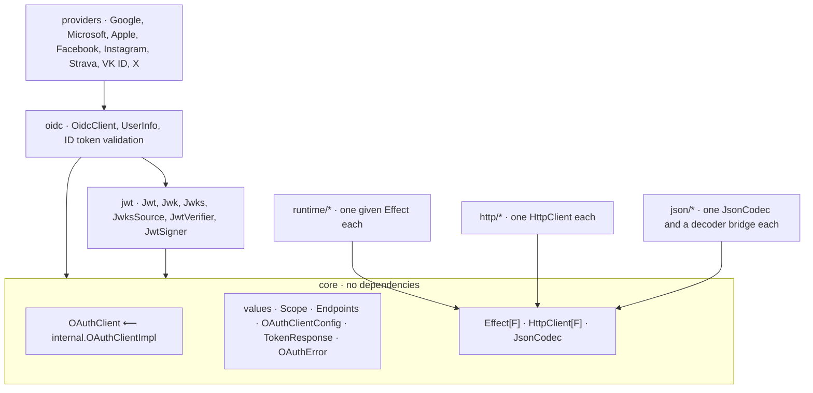

# Design notes

[← back to the README](README.md)

Why `oauth4s` is shaped the way it is. The README says what the API does. This page says what was chosen, what was
rejected and what each choice costs.

* [Principles](#principles)
* [The shape](#the-shape)
* [Three SPIs, and nothing else to plug](#three-spis-and-nothing-else-to-plug)
* [A runtime is one typeclass](#a-runtime-is-one-typeclass)
* [JSON is a tree and a codec](#json-is-a-tree-and-a-codec)
* [A client is a trait, its configuration is a value](#a-client-is-a-trait-its-configuration-is-a-value)
* [Authentication is a sum, not a secret and a flag](#authentication-is-a-sum-not-a-secret-and-a-flag)
* [The flow state is a value, not a session](#the-flow-state-is-a-value-not-a-session)
* [Errors are values, in one vocabulary](#errors-are-values-in-one-vocabulary)
* [Endpoints are checked when they are made](#endpoints-are-checked-when-they-are-made)
* [OpenID Connect is a layer, not a mode](#openid-connect-is-a-layer-not-a-mode)
* [JWT verification is native](#jwt-verification-is-native)
* [A provider is a configuration and its exceptions](#a-provider-is-a-configuration-and-its-exceptions)
* [One suite per SPI](#one-suite-per-spi)
* [Deliberately not done](#deliberately-not-done)
* [Decisions](#decisions)

## Principles

1. **Scala 3 only.** `given`-based throughout, opaque types for the protocol values, `enum` for every closed set.
2. **`core` depends on nothing.** Not on an effect system, not on a JSON library, not on an HTTP client. Each is a
   module and a `given`.
3. **The compiler refuses what the specification forbids.** No client with an optional secret, no endpoint on plain
   `http`, no token response without an access token.
4. **OAuth 2.1 is the default, OAuth 2.0 is the fallback.** PKCE is on, the implicit and password grants do not exist.
   A provider that cannot do PKCE turns it off by name.
5. **The server is not trusted.** An issuer that answers for another issuer is refused. An ID token is verified before
   its claims are read. An error response is parsed as a document, whatever status it came with.

## The shape



The dependency arrows only point down. `jwt` is usable without OAuth, `core` without JWT, and a service that only
needs client credentials pulls in `core`, a runtime and an HTTP client.

## Three SPIs, and nothing else to plug

`Effect[F]`, `HttpClient[F]` and `JsonCodec`. Each has the smallest surface the protocol needs:

```scala
trait HttpClient[F[*]]:
  def send(request: HttpRequest): F[HttpResponse]

trait JsonCodec:
  def parse(text: String): Either[JsonError, Json]
  def render(json: Json): String
```

A request is `GET` or `POST` with a `String` body, because a token request is a form and a discovery request is a
`GET`; nothing in OAuth streams. Transport failures are exceptions in `F`, and the client turns them into
`OAuthError.Transport(cause)` at the boundary, so `getCause` is the `ConnectException` and not a wrapper.

## A runtime is one typeclass

```scala
trait Effect[F[*]]:
  def pure[A](a: A): F[A]
  def delay[A](a: => A): F[A]
  def map[A, B](fa: F[A])(f: A => B): F[B]
  def flatMap[A, B](fa: F[A])(f: A => F[B]): F[B]
  def raiseError[A](error: Throwable): F[A]
  def handleErrorWith[A](fa: F[A])(f: Throwable => F[A]): F[A]
  def sleep(duration: FiniteDuration): F[Unit]

  def realTime: F[Instant]       = delay(Instant.now())
  def blocking[A](a: => A): F[A] = delay(a)
```

Seven abstract methods. `sleep` is there because the device flow polls. `realTime` and `blocking` have defaults that
every real runtime overrides: a test clock in cats-effect or ZIO moves token expiry with it, and the JDK HTTP client's
blocking `send` lands on the runtime's blocking pool instead of a compute thread.

There is no separate `Clock[F]` or `SecureRandom[F]`. A clock is one method of the runtime; randomness is
`java.security.SecureRandom` inside `delay`, and a typeclass for it would be a seam nobody substitutes.

The effect-free path is `scala.util.Try`, not a type alias to `A`. An identity effect cannot catch an error it has
already thrown and cannot sleep without lying about it; `Try` does both honestly, and its instance lives in `Effect`'s
companion so it needs no import. It is eager — the request happens when the method is called — which is what direct
style means.

## JSON is a tree and a codec

The model types are decoded once, in `core`, from a six-case `Json` enum. A JSON library plugs in below that, as the
thing that turns text into the tree, and beside it, as the decoders for the application's own types:

```scala
given circeCodec: JsonCodec                                          // text ⇄ tree, with circe's parser
given fromCirceDecoder: [A] => (decoder: Decoder[A]) => JsonDecoder[A]  // tree → A, with circe's decoder
```

The alternative — a `JsonDecoder[TokenResponse]` per library — would mean every bridge re-implements every protocol
document, and a new field means editing them all. With the tree in the middle a bridge is forty lines and never
changes.

`core` ships its own codec as the default instance, in `JsonCodec`'s companion: a recursive-descent parser with a depth
limit, a bound on number literals and offsets in its errors. It is there so that `core` plus a runtime plus the JDK
client is a working client with no third-party code in it. An imported instance wins over a companion one, so
`import CirceInstances.given` replaces it without ceremony. The cost is a parser we maintain, held to the same
conformance suite as the bridges — which is how we learned that one library accepts trailing garbage and had the
bridge refuse it.

## A client is a trait, its configuration is a value

`OAuthClient[F]` is a trait; `internal.OAuthClientImpl` is the only implementation and is private. A test double, a
metrics decorator or a caching wrapper is another implementation of the trait, not a subclass of ours.

`OAuthClientConfig`, `Endpoints`, `AuthorizationOptions`, `OidcConfig` and `JwtValidation` are final classes with
private constructors, a `default` or a small factory, and `withX` methods. Not case classes: a case class with fifteen
defaulted fields breaks binary compatibility whenever a field is added, and MiMa is run on every release. A builder
method that is added later breaks nothing.

## Authentication is a sum, not a secret and a flag

```scala
enum ClientAuthentication:
  case Public
  case SecretBasic(secret: ClientSecret)
  case SecretPost(secret: ClientSecret)
  case SecretMinted(mint: Instant => ClientSecret)
```

An `Option[ClientSecret]` next to an authentication method is four states of which two are mistakes, and a runtime
check to find them. The enum has no mistaken state. `SecretMinted` is Apple's case made general: a secret that is a
function of time, minted for each request, so a long-lived client never holds an expired one.

`toString` on the enum, on the configuration and on `TokenResponse` prints no secret and no token.

## The flow state is a value, not a session

`authorize` returns an `AuthorizationFlow(url, state, redirectUri, verifier, nonce)` and `complete(flow, callback)`
takes it back. The two ends of the flow meet in the application's code, so

- the `state` the callback must carry travels with the flow, and a forged callback is `StateMismatch` before the code
  is sent anywhere;
- the PKCE verifier and the OIDC nonce travel with it too, and a callback handled by another process still has them;
- nothing in the library decides where a session lives or when it expires.

The state is 32 random bytes. That is longer than the specification asks, because one provider requires at least 32
characters and a constant is simpler than a per-provider knob.

## Errors are values, in one vocabulary

```scala
enum OAuthError:
  case Rejected(code: ErrorCode, description: Option[String], uri: Option[String])
  case UnexpectedStatus(status: Int, body: String)
  case MalformedResponse(reason: String)
  …
```

One `Rejected` case with an `ErrorCode` enum inside, rather than a case per code: the codes are an open registry —
OAuth, the device grant, OpenID Connect and every provider add their own — and `ErrorCode.Other(raw)` keeps one the
library has never seen. Matching `Rejected(ErrorCode.InvalidGrant, _, _)` is as exhaustive as a dedicated case was.

The response is read as a document before its status is looked at. VK ID answers errors with HTTP 200; Facebook nests
the error in an object; Instagram calls the fields `error_type` and `error_message`. All three come out as `Rejected`.

## Endpoints are checked when they are made

`Endpoint.parse` returns an `Either`; `Endpoint(literal)` throws, in the spirit of `require`: a literal URL that is not
`https` is a programming error, a URL from a discovery document is input. Either way an `Endpoint` that exists is
absolute, has no fragment, and is `https` or loopback `http` — so there is no `validate` step on the configuration and
no way to skip one. The loopback exception exists because tests need a real server on `127.0.0.1`.

## OpenID Connect is a layer, not a mode

`OidcClient` holds an `OAuthClient` and a `JwksSource`. It adds `openid` and a nonce on the way out, and on the way
back refuses a response without an ID token, verifies it, and checks `at_hash` against the access token that came with
it. A flag on the OAuth client would have made every one of those checks an `if`, and "forgot to turn the flag on" a
vulnerability.

Keys are fetched lazily, kept for an hour, and fetched again when a token names an unknown `kid` — but not more often
than once a minute, so a stream of tokens with made-up key ids cannot make us hammer the provider.

## JWT verification is native

`java.security` verifies RSA (PKCS#1 and PSS), ECDSA and HMAC. ECDSA uses the JDK's `…inP1363Format` signatures, which
are the `r || s` concatenation JWS uses, so there is no DER conversion to get wrong. The algorithm comes from an
allow-list on the validation, never from the token alone; the default list has no symmetric algorithm, which is what
stops a token signed with the public key as an HMAC secret. `crit` headers are refused outright: a token that requires
an extension this library does not implement is a token whose meaning is unknown.

## A provider is a configuration and its exceptions

Every provider object exposes `config(…)`, `apply`, `from(config)` and a pure `profile(json)`. What differs between
providers is expressed with the same four knobs of the core client rather than with provider-specific code paths:

| Knob | Who needs it |
| --- | --- |
| `withScopeSeparator(",")` | Facebook, Instagram, Strava |
| `forwardingCallbackParameter("device_id")` | VK ID |
| `adaptingTokenResponse(json => …)` | Instagram, whose token arrives inside `data` |
| `ClientAuthentication.SecretMinted` | Apple |

Endpoints are constants, not discovered, so building a provider performs no I/O and cannot fail at start-up because a
discovery endpoint is slow. The constants were checked against each provider's documentation and live metadata, and
the versions that move (Graph API `v27.0`) are parameters.

## One suite per SPI

`RuntimeSuite[F]`, `JsonCodecSuite` and `HttpClientSuite[F]` live in `testkit`'s tests. A runtime, a JSON bridge or an
HTTP client binds its suite in three lines and is then held to the same behaviour as the others: errors thrown inside
`map` are caught, a malformed document is refused, a refused connection is a `Transport`. The HTTP suite runs against
`FakeAuthorizationServer` over real sockets — it verifies PKCE, rotates refresh tokens and answers the device flow — so
a form encoded with the wrong space or a header that was never sent fails a test instead of a production login.

The integration tests compile on the next Scala release, so a deprecation becomes a red build before it becomes an
error. They also hold the documentation: every Scala block in the README and the recipes is a fragment of a file the
`it` module compiles, and the recipes are run.

## Deliberately not done

- **A session-based client.** `authorize` and `complete` are two calls on purpose.
- **OAuth 1.0a and OpenID 2.0.** Both are dead.
- **The implicit and password grants.** OAuth 2.1 removed them; `requestToken` is the escape hatch for a custom grant.
- **Single-flight refresh in `TokenSource`.** It needs a `Deferred`, which is a runtime concept `core` does not have.
- **Logging.** An OAuth client sees the secrets. It logs nothing.
- **Retries.** A `5xx` from a token endpoint is reported. The caller knows whether a retry is safe for the grant.

## Decisions

| Decision | Alternative | Why |
| --- | --- | --- |
| three SPIs with a default JSON codec | a JSON library in `core` | `core` depends on nothing and still works alone |
| a JSON tree between the wire and the model | a decoder per document per library | a bridge is written once and never edited |
| `Try` for the effect-free path | an identity effect | it can catch, and it can sleep |
| `realTime` and `blocking` on `Effect` | `Clock[F]`, `Blocker[F]` typeclasses | one instance per runtime |
| trait plus private implementation | a final class | decorators and test doubles |
| `withX` builders | case classes with defaults | adding an option stays binary compatible |
| `ClientAuthentication` enum | optional secret plus method | no invalid combination to validate |
| one `Rejected` case with `ErrorCode` | a case per error code | the registry is open |
| `Endpoint` validated at construction | `config.validate` | nothing to forget |
| OIDC as a separate client | a flag on the OAuth client | every check is unconditional |
| hard-coded provider endpoints | discovery at start-up | construction is pure and cannot fail |
| a fake authorization server in `testkit` | Testcontainers and Keycloak | no Docker, the same checks, usable by applications |
