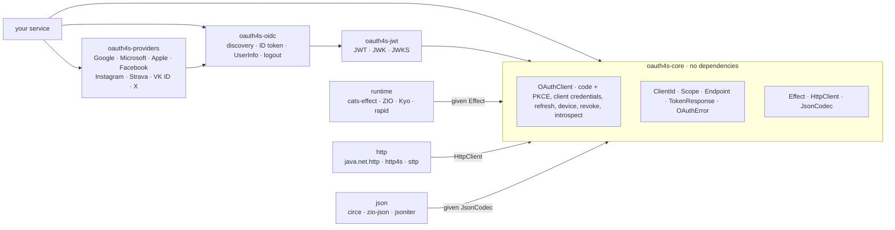

<p align="center">
  <picture>
    <source media="(prefers-color-scheme: dark)" srcset="logos/oauth4s-dark.svg">
    
  </picture>
</p>

# oauth4s

OAuth 2.0 / 2.1 and OpenID Connect client for `Scala 3`, with Google, Microsoft, Apple and five more providers ready to
use. No hardcoded `cats-effect`, `ZIO` or `Kyo`, no JSON library and no HTTP client: the runtime (`cats-effect` /
`ZIO` / `Kyo` / `rapid`), the codec (`circe` / `zio-json` / `jsoniter`) and the transport (`java.net.http` / `http4s` /
`sttp`) are modules wired in through a `given`, and `core` depends on nothing.

[](https://github.com/sendline-now/oauth4s/actions/workflows/ci.yml)
[](https://central.sonatype.com/search?q=g:now.sendline%20oauth4s)
[](https://oss.sendline.now/oauth4s/)
[](https://www.scala-lang.org/)
[](https://www.apache.org/licenses/LICENSE-2.0)

The checks a specification asks people to remember are what the types do:

- **PKCE is on unless you turn it off.** `authorize` generates the verifier and keeps it in the flow, `complete` sends
  it back. OAuth 2.1 is the default, and OAuth 2.0 is what a provider gets when it cannot do better.
- **State is checked where the callback arrives.** `complete(flow, callback)` compares the `state`, and the issuer of
  RFC 9207 when the server sends one, before the code goes anywhere.
- **A client that needs a secret cannot be built without one.** `ClientAuthentication` is `Public`, `SecretBasic`,
  `SecretPost` or `SecretMinted`. There is no optional secret to forget.
- **An endpoint is `https`, or loopback.** `Endpoint` refuses anything else, in your configuration and in a discovery
  document alike.
- **An ID token is verified before it is read.** Signature against the provider's keys, `iss`, `aud`, `azp`, `exp`,
  `nonce` and `at_hash`. Symmetric algorithms and `none` are off by default.
- **An error is a value.** `OAuthError.Rejected(ErrorCode.InvalidGrant, …)` is a pattern, not a string comparison, and
  the providers that answer in their own dialect are read into the same value.



* [Quick start](#quick-start)
* [The authorization code flow](#the-authorization-code-flow)
* [Other grants](#other-grants)
* [OpenID Connect](#openid-connect)
* [Providers](#providers)
* [JWT, JWK and JWKS](#jwt-jwk-and-jwks)
* [Errors](#errors)
* [Runtimes](#runtimes)
* [HTTP clients](#http-clients)
* [JSON codecs](#json-codecs)
* [Testing](#testing)
* [Modules](#modules)
* [Known gaps](#known-gaps)
* [Contributing](#contributing)
* [Recipes](RECIPES.md), [Design notes](DESIGN.md), [Roadmap](ROADMAP.md), [Changelog](CHANGELOG.md),
  [Compatibility](COMPATIBILITY.md), [Benchmarks](BENCHMARKS.md)

## Quick start

Runs on JDK 17 or newer. `oauth4s-rapid` needs 21 and `oauth4s-kyo` needs 25, like the libraries they wrap.

```scala
libraryDependencies ++= Seq(
  "now.sendline" %% "oauth4s-cats"      % "0.1.1", // core + cats-effect
  "now.sendline" %% "oauth4s-http-jdk"  % "0.1.1", // java.net.http: no HTTP library to add
  "now.sendline" %% "oauth4s-providers" % "0.1.1", // Google, Microsoft, Apple, …; brings oidc and jwt
  "now.sendline" %% "oauth4s-testkit"   % "0.1.1" % Test,
)
```

```scala
import cats.effect.IO

import oauth4s.*
import oauth4s.http.HttpClient
import oauth4s.http.jdk.JdkHttpClient
import oauth4s.providers.{Google, Login}

import oauth4s.runtime.cats.CatsInstances.given

given HttpClient[IO] = JdkHttpClient[IO]()

val google   = Google[IO](ClientId("…apps.googleusercontent.com"), ClientSecret("…"))
val redirect = RedirectUri("https://app.example.com/callback")

// 1. send the browser to flow.url and keep the flow next to the user's session
val start: IO[AuthorizationFlow] = google.authorize(redirect)

// 2. the provider sends the browser back
def signedIn(flow: AuthorizationFlow, requestUrl: String): IO[Login] =
  google.login(flow, AuthorizationCallback.fromUrl(requestUrl))
```

`Login` is the tokens and a `UserProfile(provider, id, name, username, email, emailVerified, picture, raw)`. Inside
`login` the state was compared, the code was exchanged with the PKCE verifier, the ID token was verified against
Google's keys and the nonce of this flow, and the profile was read.

Every piece is replaceable without touching the code between the imports:

| To change | Swap | For |
| --- | --- | --- |
| the runtime | `oauth4s-cats` and its import | `oauth4s-zio`, `oauth4s-kyo`, `oauth4s-rapid`, or nothing at all for `scala.util.Try` |
| the HTTP client | `oauth4s-http-jdk` and `JdkHttpClient` | `oauth4s-http4s`, `oauth4s-sttp`, or twelve lines of your own |
| the JSON library | nothing: a codec is built in | `oauth4s-circe`, `oauth4s-zio-json`, `oauth4s-jsoniter` |
| the provider | `Google` | another of the [eight](#providers), any OpenID Connect issuer, or a plain OAuth 2.0 server |

## The authorization code flow

A client is a configuration: who you are, how you authenticate and where the server is.

```scala
val endpoints = Endpoints.of(Endpoint("https://auth.example.com/authorize"), Endpoint("https://auth.example.com/token"))
val config    = OAuthClientConfig(ClientId("client-1"), ClientAuthentication.SecretBasic(ClientSecret("s3cret")), endpoints)
val client    = OAuthClient[IO](config.withScope(Scope.of("read", "write")))

// or from the server's own description: RFC 8414 first, the OpenID configuration second
val discovered: IO[OAuthClient[IO]] =
  OAuthClient.discover[IO](Issuer("https://auth.example.com"), ClientId("client-1"), ClientAuthentication.Public)
```

The flow is two calls, because it is two HTTP requests of yours with a browser round trip between them:

```scala
// the first request: remember the flow, send the browser to its url
def signIn(remember: AuthorizationFlow => IO[Unit]): IO[String] =
  for
    flow <- client.authorize(redirect, AuthorizationOptions.scoped("read").withPrompt("consent"))
    _    <- remember(flow)
  yield flow.url

// the second request: the provider sent the browser back to the redirect URI
def callback(flow: AuthorizationFlow, requestUrl: String): IO[TokenResponse] =
  client.complete(flow, AuthorizationCallback.fromUrl(requestUrl))
```

`complete` returns a `TokenResponse`: `accessToken`, `tokenType`, `expiresIn` and the `expiresAt` computed from it,
`refreshToken`, `scope`, `idToken`, and `raw`, the whole document, for whatever else the server put there.

### What a flow carries

`AuthorizationFlow` is a plain case class, and it is the whole state of the flow:

| Field | What it is for |
| --- | --- |
| `url` | where to send the browser |
| `state` | 32 random bytes; the callback must bring it back |
| `redirectUri` | sent again with the code, as the specification requires |
| `verifier` | the PKCE code verifier; its SHA-256 went out in `url` |
| `nonce` | present when the flow asked for one; an ID token must repeat it |

Where it lives between the two requests — a server-side session, an encrypted cookie, a row keyed by `state` — is the
application's decision. [A recipe](RECIPES.md#keeping-the-flow-between-two-requests) keeps it in memory keyed by state.

### What `complete` checks

1. The callback has no `error`. If it has, the flow fails with that error as a `Rejected` and nothing is sent.
2. The callback's `state` is the flow's. Otherwise `StateMismatch`: this is the CSRF check.
3. If the configuration knows its issuer and the callback has an `iss`, they are equal. Otherwise `IssuerMismatch`: this
   is the mix-up defence of RFC 9207.
4. There is a `code`.

Only then is the code exchanged, together with the verifier and the redirect URI.

### Client authentication

```scala
val authentication: List[ClientAuthentication] =
  List(
    ClientAuthentication.Public,                              // a browser, a mobile or a desktop application
    ClientAuthentication.SecretBasic(ClientSecret("s3cret")), // Authorization: Basic, what RFC 6749 prefers
    ClientAuthentication.SecretPost(ClientSecret("s3cret")),  // client_id and client_secret in the form
    ClientAuthentication.SecretMinted(minted),                // a secret made for each request, from the time it is made at
  )
```

There is no way to say "Basic, but I forgot the secret". `SecretMinted` takes an `Instant => ClientSecret`, for a secret
that is a function of time: Apple's is a JWT that expires, so it is signed again for every request.

### Configuration

```scala
val tuned: OAuthClientConfig =
  config
    .withIssuer(Issuer("https://auth.example.com"))                    // compared with the `iss` of the callback, RFC 9207
    .withScope(Scope.of("read"))                                       // what a flow asks for when it names no scope
    .withScopeSeparator(",")                                           // for the providers that do not use a space
    .withAuthorizationParameter("audience", "https://api.example.com") // on every authorization request
    .withTokenParameter("audience", "https://api.example.com")         // on every token request
    .forwardingCallbackParameter("device_id")                          // from the callback into the code exchange
    .withUserAgent("billing/1.4")
```

`Endpoints` is built the same way: `Endpoints.of(authorization, token)` and `withDeviceAuthorization`,
`withRevocation`, `withIntrospection`, `withUserInfo`, `withJwks`, `withEndSession`. A method that needs an endpoint the
client does not have fails with `OAuthError.MissingEndpoint`.

An `Endpoint` is absolute, has no fragment, and is `https`, or `http` on `localhost` and `127.0.0.1`.
`Endpoint("http://auth.example.com/token")` throws where it is written; `Endpoint.parse` returns an `Either`, and that
is what reads a discovery document, so a server that advertises a plain `http` token endpoint is refused before a
secret is sent to it.

### Options of one flow

```scala
val options: AuthorizationOptions =
  AuthorizationOptions.default
    .withScope(Scope.of("read", "write"))
    .withNonce                 // a nonce in the request and in the flow
    .withPrompt("consent")
    .withLoginHint("ann@example.com")
    .withParameter("ui_locales", "ru")
    .withPkce(PkceMethod.S256) // the default; withoutPkce for a provider that refuses the parameters
```

### Callbacks

```scala
def posted(flow: AuthorizationFlow, requestBody: String): IO[TokenResponse] =
  client.complete(flow, AuthorizationCallback.fromForm(requestBody)) // response_mode=form_post

def denied(requestUrl: String): Option[OAuthError] =
  AuthorizationCallback.fromUrl(requestUrl).error // Some(Rejected(AccessDenied, …)) when the user said no
```

`AuthorizationCallback.fromParameters` takes the parameters when a web framework has already parsed them. The fragment
of a URL is ignored, so Instagram's `#_` is not part of the code.

## Other grants

```scala
val machine: IO[TokenResponse]   = client.clientCredentials(Scope.of("read")) // RFC 6749 §4.4
val renewed: IO[TokenResponse]   = client.refresh(refreshToken)               // RFC 6749 §6
val revoked: IO[Unit]            = client.revokeRefreshToken(refreshToken)    // RFC 7009
val inspected: IO[Introspection] = client.introspect(accessToken)             // RFC 7662

val exchanged: IO[TokenResponse] = // RFC 8693, or any grant the client has no method for
  client.requestToken(
    GrantType.TokenExchange,
    Seq("subject_token" -> accessToken.value, "subject_token_type" -> "urn:ietf:params:oauth:token-type:access_token"),
  )

val onDevice: IO[TokenResponse] =
  for
    device <- client.deviceAuthorization(Scope.of("read")) // RFC 8628
    _      <- IO.println(s"enter ${device.userCode.value} at ${device.verificationUri}")
    token  <- client.awaitDevice(device)                   // polls at the server's interval, backs off on slow_down
  yield token
```

`awaitDevice` returns when the user has approved the device, fails with the server's error when they have refused, and
fails with `expired_token` when the device code has run out — it never waits past `expiresIn`.

Revocation succeeds on any `2xx`, including for a token the server no longer knows, as RFC 7009 asks.
`revokeAccessToken` is the other half. Introspection reads `active`, `scope`, `client_id`, `username`, `sub`, `aud`,
`iss`, `exp`, `iat`, `nbf`, `jti`, and keeps the document in `raw`.

### A token that stays fresh

A service that calls another service does not want a grant, it wants a token that is always valid:

```scala
val service: TokenSource[IO] = TokenSource.clientCredentials(client, Scope.of("read"))
val user: TokenSource[IO]    = TokenSource.refreshing(client, stored)

def call[A](request: AccessToken => IO[A]): IO[A] =
  service.accessToken.flatMap(request) // asks once, then serves from memory until a minute before the expiry

val refused: IO[Unit] = service.invalidate // the resource server answered 401: the next call asks again

def active(token: AccessToken): IO[Boolean] =
  client.introspect(token).map(answer => answer.active && answer.scope.exists(_.contains("read")))
```

`TokenSource.refreshing` starts from a token you already have — a user's, loaded from your database — and uses its
refresh token. When the server answers without a new refresh token, the old one is kept; when it rotates, the new one
replaces it. The leeway is a minute and is the last parameter of both constructors.

## OpenID Connect

`oauth4s-oidc` is the same client plus what makes a token an identity.

```scala
val discovered: IO[OidcClient[IO]] =
  OidcClient.discover[IO](Issuer("https://auth.example.com"), ClientId("client-1"), ClientAuthentication.Public)

def start(oidc: OidcClient[IO]): IO[AuthorizationFlow] =
  oidc.authorize(redirect, AuthorizationOptions.scoped("email")) // openid and a nonce are added for you

def finish(oidc: OidcClient[IO], flow: AuthorizationFlow, requestUrl: String): IO[(Option[String], Option[String], UserInfo)] =
  for
    tokens <- oidc.complete(flow, AuthorizationCallback.fromUrl(requestUrl)) // exchanges the code, then verifies the ID token
    info   <- oidc.userInfo(tokens.response.accessToken)
  yield (tokens.user.subject, tokens.user.email, info)
```

`OidcTokens` is the token response and the verified ID token. `tokens.user` reads its claims as the standard ones —
`subject`, `name`, `givenName`, `familyName`, `preferredUsername`, `email`, `emailVerified`, `picture`, `locale` — and
`UserInfo` reads the same from the UserInfo endpoint.

### What `complete` verifies

After everything the OAuth client checks, and before it returns:

| Check | Failure |
| --- | --- |
| the response has an `id_token` | `OAuthError.MissingField("id_token")` |
| `alg` is on the allow-list: asymmetric algorithms only, unless you say otherwise | `JwtError.AlgorithmNotAllowed`, `UnsupportedAlgorithm` |
| no `crit` header | `JwtError.UnsupportedCritical` |
| the signature verifies with a key of the provider | `JwtError.InvalidSignature`, `UnknownKey` |
| `exp` is in the future and `nbf` in the past, with a minute of leeway | `JwtError.Expired`, `NotYetValid`, `MissingClaim("exp")` |
| `iss` is the issuer | `JwtError.IssuerMismatch` |
| `aud` contains the client id | `JwtError.AudienceMismatch` |
| `azp`, when present, is the client id; it must be present when there are several audiences | `JwtError.InvalidClaim("azp", …)`, `MissingClaim("azp")` |
| `nonce` is the flow's | `JwtError.NonceMismatch` |
| `at_hash`, when present, matches the access token | `JwtError.InvalidClaim("at_hash", …)` |

A failed check fails the effect with a `JwtException`.

### The provider's keys

The key set is fetched from `jwks_uri` the first time a token is verified and kept for an hour. A token that names a
key id the set does not have triggers a refetch — that is how a rotation is picked up — but at most once a minute, so
tokens with invented key ids cannot be turned into requests to the provider.

### Verifying alone, and signing out

```scala
def verified(oidc: OidcClient[IO], idToken: IdToken): IO[Jwt] =
  oidc.verify(idToken) // the checks of complete, for an ID token that arrived another way

def signOut(oidc: OidcClient[IO], idToken: IdToken): Either[OAuthError, String] =
  oidc.logoutUrl(Some(idToken), Some(RedirectUri("https://app.example.com/bye"))) // where to send the browser
```

### Without discovery

```scala
def byHand(client: OAuthClientConfig): OidcConfig =
  OidcConfig(client, Issuer("https://auth.example.com"))
    .withKeysLifetime(6.hours)   // how long the provider's keys are kept
    .withKeysCooldown(5.minutes) // how often an unknown key id may cause a refetch
    .withValidation(_.withLeeway(30.seconds))
```

The client's endpoints must include the key set (`Endpoints.withJwks`). The leeway is the clock skew an expiry is
forgiven, a minute by default; `withValidation` reaches everything else a
[`JwtValidation`](#jwt-jwk-and-jwks) has.

## Providers

A provider is the endpoints, the default scope and everything the provider does differently, behind one interface:

| Member | What it does |
| --- | --- |
| `authorize(redirectUri, options)` | starts a flow, with the provider's scope unless the options name one |
| `login(flow, callback)` | finishes it: tokens and a `UserProfile` |
| `profile(tokens)` | the profile again, from tokens you kept |
| `oauth` | the `OAuthClient` underneath: refresh, revoke, anything else |

| Provider | Protocol | PKCE | Client authentication | Profile comes from | Email |
| --- | --- | --- | --- | --- | --- |
| `Google` | OAuth 2.0 + OIDC | S256 | secret in the form | the UserInfo endpoint | yes, with `email_verified` |
| `Microsoft` | OAuth 2.0 + OIDC | S256 | secret in the form | Microsoft Graph's UserInfo | yes, never verified |
| `Apple` | OAuth 2.0, OIDC-like | off | an ES256 JWT minted per request | the ID token, and `user` on the first sign-in | yes, may be a relay address |
| `Facebook` | OAuth 2.0 | off | secret in the form | Graph API `/me` | when the user has one |
| `Instagram` | Meta OAuth 2.0 | off | secret in the form | Graph API `/me` | no |
| `Strava` | OAuth 2.0 | off | secret in the form | the `athlete` in the token response | no |
| `VkId` | OAuth 2.1 | S256, mandatory | none: a public client | `user_info`, by `POST` | with the `email` scope |
| `X` | OAuth 2.0 + PKCE | S256, mandatory | Basic, or none for a public client | `/2/users/me` | with the `users.email` scope |

What `login` puts in the `UserProfile`. The `id` is the key to store an account under, and the only one a provider
promises to keep. Link a new sign-in to an existing account by its email only when `emailVerified` is `Some(true)`. A
`None` means the provider does not say, and an address it does not vouch for may belong to someone else.

| Provider | `id` | `id` stays the same | `email` | `emailVerified` |
| --- | --- | --- | --- | --- |
| `Google` | `sub` | for the Google account | with the `email` scope | the `email_verified` claim |
| `Microsoft` | `sub` | for the account, and different in each application | the `email` claim | `None`: Microsoft does not verify it, and in a work tenant an administrator sets it |
| `Apple` | `sub` | for the Apple ID, within one developer team | on every sign-in, may be a private relay address | the `email_verified` claim |
| `Facebook` | `id` | for the user, and different in each application | when the user has one | `None` |
| `Instagram` | `user_id` | for the account, and different in each application | never | `None` |
| `Strava` | the athlete's `id` | for the athlete | never | `None` |
| `VkId` | `user_id` | for the VK account | with the `email` scope | `None`: VK ID's `user_info` carries no verification flag, so treat the address as unconfirmed |
| `X` | `id` | for the account | `confirmed_email`, with the `users.email` scope | `Some(true)` when there is one, since X only returns a confirmed address |

### Google

```scala
val google: Provider[IO] = Google[IO](id, secret)

val withRefreshToken: IO[AuthorizationFlow] =
  google.authorize(redirect, Google.Offline) // access_type=offline and prompt=consent
```

Google returns a refresh token on the first consent only; `Google.Offline` asks for consent again so that it returns
one every time. The ID token's issuer is accepted in both spellings Google uses, with and without `https://`.

### Microsoft

```scala
val microsoft: Provider[IO] = Microsoft[IO](id, secret)                          // Microsoft.Common: any account
val workOnly: Provider[IO]  = Microsoft[IO](id, secret, Microsoft.Organizations) // or Microsoft.Consumers, or a tenant id
```

The multi-tenant endpoints publish an issuer with a placeholder in it, so the issuer cannot be compared as a string.
The token's `tid` claim names its tenant, the issuer must be that tenant's, and when you gave a tenant id, `tid` must
be it. Microsoft has no email-verified flag and says not to use the email for authorization; `emailVerified` is `None`.

### Apple

```scala
def apple(p8: String): Provider[IO] =
  val key = JwtSigner.privateKey(p8, "EC").fold(error => throw error.toThrowable, identity)

  Apple[IO](ClientId("com.example.web"), "TEAM123456", "KEY1234567", key) // Services ID, Team ID, Key ID

def appleCallback(provider: Provider[IO], flow: AuthorizationFlow, requestBody: String): IO[Login] =
  provider.login(flow, AuthorizationCallback.fromForm(requestBody)) // Apple posts; `user` comes on the first sign-in only
```

Apple's client secret is a JWT signed with your key, valid for five minutes and made again for each request. Apple has
no profile endpoint: the id and the email come from the ID token, and the name comes once, in the `user` field of the
first callback, so keep it when it arrives. Apple does not allow `localhost` as a redirect URI.

### Facebook

```scala
val facebook: Provider[IO] = Facebook[IO](id, secret)

def sixtyDays(token: AccessToken): IO[TokenResponse] =
  Facebook.longLived(facebook, token) // fb_exchange_token
```

Facebook issues no refresh tokens; a short-lived token is exchanged for one that lasts about sixty days. The Graph API
version is `Facebook.Version` and is a parameter of `Facebook(…)` and `Facebook.config(…)`.

### Instagram

```scala
val instagram: Provider[IO] = Instagram[IO](id, secret)

def instagramSixtyDays(token: AccessToken): IO[TokenResponse] =
  Instagram.longLived[IO](secret, token) // ig_exchange_token, on graph.instagram.com

def instagramAgain(token: AccessToken): IO[TokenResponse] =
  Instagram.refreshed[IO](token) // ig_refresh_token, for a long-lived token that is at least a day old
```

This is the Instagram API with Instagram Login, for professional accounts. The Basic Display API it replaced was shut
down in December 2024.

### Strava

```scala
val strava: Provider[IO] = Strava[IO](id, secret)

val activities: IO[AuthorizationFlow] =
  strava.authorize(redirect, AuthorizationOptions.scoped("read", "activity:read")) // sent as read,activity:read
```

Users can untick scopes on Strava's consent screen: `tokens.scope` is what was granted. Strava rotates refresh tokens,
and the old one stops working at once.

### VK ID

```scala
val vk: Provider[IO] = VkId[IO](id)

def vkAgain(token: RefreshToken, callback: AuthorizationCallback, state: State): IO[TokenResponse] =
  VkId.refresh(vk, token, callback.parameter(VkId.DeviceId).getOrElse(""), state) // the device_id of the first callback
```

VK ID returns a `device_id` on the callback and wants it back in the code exchange and in every refresh; the exchange is
handled, the refresh needs the value you kept. Errors arrive with HTTP 200 and are read as errors all the same.
`VkId.config(clientId, serviceToken)` adds the service token of a confidential application.

### X

```scala
val x: Provider[IO]       = X[IO](id, secret) // a confidential client: Basic authentication
val xPublic: Provider[IO] = X.public[IO](id)  // a public client: PKCE alone

val xWithRefreshToken: IO[AuthorizationFlow] =
  x.authorize(redirect, AuthorizationOptions.default.withScope(X.Offline)) // adds offline.access
```

An authorization code from X lives thirty seconds. The email is in the profile only when the application asks for the
`users.email` scope.

### Changing what a provider does

Every provider object has `config(…)`, which returns the configuration it would use, and `from(config)`, which builds
the provider from one you changed. Each `profile(json)` is a pure function you can test against a recorded response.

```scala
val olderGraph: Provider[IO] =
  Facebook.from(Facebook.config(id, secret, version = "v26.0").withScope(Scope.of("public_profile")))

def whoIs(provider: Provider[IO], tokens: TokenResponse): IO[UserProfile] =
  provider.profile(tokens) // the profile again, later, from tokens you kept

def revoke(tokens: TokenResponse): IO[Unit] =
  google.oauth.revokeAccessToken(tokens.accessToken) // the OAuth client underneath, for everything else
```

For a provider that is not in the list, see [a provider of your own](RECIPES.md#a-provider-of-your-own).

## JWT, JWK and JWKS

`oauth4s-jwt` works on its own, on `java.security` only. It is what a resource server needs to check the bearer
tokens it is sent.

```scala
val keys: JwksSource[IO] = JwksSource.remote[IO](Endpoint("https://auth.example.com/jwks"))

val rules: JwtValidation =
  JwtValidation
    .of(issuer = "https://auth.example.com", audience = "https://api.example.com")
    .withLeeway(30.seconds)

def verified(token: String): IO[Jwt] =
  JwtVerifier.verify[IO](token, keys, rules) // fails with a JwtException; refetches the keys on an unknown key id

def offline(token: String, jwks: Jwks): Either[JwtError, Jwt] =
  JwtVerifier.verify(token, jwks, rules, Instant.now()) // no effect, no network
```

```scala
def read(jwt: Jwt): (Option[String], Vector[String], Option[Instant], Vector[String]) =
  (jwt.claims.subject, jwt.claims.audience, jwt.claims.expiresAt, jwt.claims.raw.strings("roles"))

val stricter: JwtValidation =
  rules
    .withAlgorithms(JwsAlgorithm.ES256, JwsAlgorithm.RS256) // the default is every asymmetric algorithm
    .withCheck(claims => Either.cond(claims.string("tenant").contains("acme"), (), JwtError.InvalidClaim("tenant", "another tenant's token")))
```

| Family | Algorithms | Key |
| --- | --- | --- |
| RSA PKCS#1 | `RS256`, `RS384`, `RS512` | JWK `RSA` |
| RSA PSS | `PS256`, `PS384`, `PS512` | JWK `RSA` |
| ECDSA | `ES256`, `ES384`, `ES512` | JWK `EC` on `P-256`, `P-384`, `P-521` |
| HMAC | `HS256`, `HS384`, `HS512` | JWK `oct`; not accepted unless `withAlgorithms` names it |

The algorithm of a token has to be on the validation's list and has to fit the key: a token signed with a public key
used as an HMAC secret is refused, not verified. A key set with a key the library cannot use — an `OKP` key, a broken
one — still serves the rest.

### Signing

```scala
def signed(key: PrivateKey, now: Instant): Either[JwtError, String] =
  val claims = Json.obj("iss" -> Json.str("billing"), "aud" -> Json.str("https://auth.example.com"), "exp" -> Json.num(now.getEpochSecond + 300))

  JwtSigner.sign(claims, JwsAlgorithm.ES256, key, Some("key-1"))

def fromFile(pem: String): Either[JwtError, PrivateKey] =
  JwtSigner.privateKey(pem, "EC") // a PKCS#8 "BEGIN PRIVATE KEY" file; "RSA" for an RSA key
```

## Errors

Every failure the library raises in `F` is an `OAuth4sException`, and there are two of them. An `OAuthException`
carries an `OAuthError`: the server refused, answered something unreadable or could not be reached. A `JwtException`
carries a `JwtError`: an ID token or a JWT did not verify. `Provider.login` and `OidcClient.complete` raise either, so a
sign-in endpoint that turns refusals into a 4xx catches `OAuth4sException`. Catching only `OAuthException` there would
let a forged or foreign ID token through to a 500.

An `OAuthException` is matched on its `error`:

```scala
def renewed(client: OAuthClient[IO], token: RefreshToken): IO[Option[TokenResponse]] =
  client.refresh(token).map(Option(_)).recoverWith { case failure: OAuthException =>
    failure.error match
      case OAuthError.Rejected(ErrorCode.InvalidGrant, _, _) => IO.none              // revoked or expired: sign in again
      case OAuthError.Transport(cause)                       => IO.raiseError(cause) // the network: safe to try again
      case other                                             => IO.raiseError(IllegalStateException(other.message))
  }
```

| `OAuthError` | When |
| --- | --- |
| `Rejected(code, description, uri)` | the server answered with an error document, or the callback carried one |
| `UnexpectedStatus(status, body)` | a status that is not `2xx` with a body that is not an error document |
| `MalformedResponse(reason)` | a `2xx` that is not JSON, or has a field of the wrong shape |
| `MissingField(name)` | a response without something the protocol requires, such as `access_token`, or stored fields given to `AuthorizationFlow.fromFields` without `state` |
| `MissingEndpoint(name)` | the client was asked for something its configuration has no endpoint for |
| `StateMismatch(expected, received)` | the callback is not this flow's |
| `IssuerMismatch(expected, received)` | the callback or the discovery document speaks for another issuer |
| `InvalidUrl(url, reason)` | an endpoint in a discovery document cannot be used |
| `InvalidCodeVerifier(reason)` | `CodeVerifier.parse` or `AuthorizationFlow.fromFields` was given something RFC 7636 does not allow |
| `Transport(cause)` | the HTTP client threw; `getCause` of the exception is that cause |

`ErrorCode` has the codes of RFC 6749, the device grant and OpenID Connect — `InvalidGrant`, `InvalidClient`,
`AccessDenied`, `AuthorizationPending`, `SlowDown`, `ExpiredToken`, `LoginRequired`, `ConsentRequired` and the rest —
and `Other(raw)` for one a provider made up. An error document is read whatever its status: VK ID sends errors with
HTTP 200, Facebook nests the error in an object, Instagram names the fields differently, and all three are `Rejected`.

A `JwtException` is matched on its `JwtError`, before the `OAuthException` case:

```scala
def signedIn(oidc: OidcClient[IO], flow: AuthorizationFlow, callback: AuthorizationCallback): IO[Either[String, OidcTokens]] =
  oidc.complete(flow, callback).attempt.map {
    case Right(tokens)                                                          => Right(tokens)
    case Left(failure: JwtException) if failure.error == JwtError.NonceMismatch => Left("this sign-in was started somewhere else")
    case Left(failure: JwtException)                                            => Left(s"the ID token was refused: ${failure.error.message}")
    case Left(failure: OAuthException)                                          => Left(failure.error.message)
    case Left(other)                                                            => Left(other.getMessage)
  }
```

Nothing in the library prints a secret: `toString` of a configuration, of a `ClientAuthentication` and of a
`TokenResponse` leaves tokens and secrets out, and the library logs nothing.

## Runtimes

| Module | Import | Effect |
| --- | --- | --- |
| `oauth4s-cats` | `oauth4s.runtime.cats.CatsInstances.given` | any `F` with `cats.effect.Async` |
| `oauth4s-zio` | `oauth4s.runtime.zio.ZioInstances.given` | `zio.Task` |
| `oauth4s-kyo` | `oauth4s.runtime.kyo.KyoInstances.given` | `KIO[A] = A < (Async & Abort[Throwable])` |
| `oauth4s-rapid` | `oauth4s.runtime.rapid.RapidInstances.given` | `rapid.Task` |
| `oauth4s-core` | nothing | `scala.util.Try`, on the calling thread |

Code that is written against `Effect[F]` does not know which one it runs on:

```scala
final class Billing[F[*]](client: OAuthClient[F])(using F: Effect[F]):
  private val tokens = TokenSource.clientCredentials(client, Scope.of("invoices:read"))

  def invoices(fetch: AccessToken => F[List[String]]): F[List[String]] =
    F.flatMap(tokens.accessToken)(fetch)
```

```scala
import cats.effect.IO

import oauth4s.http.HttpClient
import oauth4s.http.jdk.JdkHttpClient

import oauth4s.runtime.cats.CatsInstances.given

given HttpClient[IO] = JdkHttpClient[IO]()

def billing(config: OAuthClientConfig): Billing[IO] = Billing(OAuthClient[IO](config))
```

```scala
import zio.Task

import oauth4s.http.HttpClient
import oauth4s.http.jdk.JdkHttpClient

import oauth4s.runtime.zio.ZioInstances.given

given HttpClient[Task] = JdkHttpClient[Task]()

def billing(config: OAuthClientConfig): Billing[Task] = Billing(OAuthClient[Task](config))
```

Without an effect system the effect is `Try`, and its instance needs no import:

```scala
import scala.util.Try

import oauth4s.http.HttpClient
import oauth4s.http.jdk.JdkHttpClient

given HttpClient[Try] = JdkHttpClient[Try]()

def token(config: OAuthClientConfig): Try[TokenResponse] =
  OAuthClient[Try](config).clientCredentials() // the request has happened by the time this returns
```

`Effect[F]` is `pure`, `delay`, `map`, `flatMap`, `raiseError`, `handleErrorWith` and `sleep`, plus `realTime` and
`blocking`, which have defaults that each runtime replaces with its own clock and its own blocking pool. A test clock
in cats-effect or ZIO therefore moves token expiry with it.

## HTTP clients

| Module | Client |
| --- | --- |
| `oauth4s-http-jdk` | `java.net.http.HttpClient`, part of the JDK |
| `oauth4s-http4s` | any `org.http4s.client.Client[F]` |
| `oauth4s-sttp` | any sttp client 4 `Backend[F]` |

```scala
val jdk: HttpClient[IO] = JdkHttpClient[IO](timeout = 10.seconds)

def shared(client: JavaHttpClient): HttpClient[IO] = JdkHttpClient.from[IO](client) // one you configured: a proxy, an SSL context

def onHttp4s(client: Client[IO]): HttpClient[IO] = Http4sHttpClient(client) // ember, blaze, the JDK client — any http4s Client

def onSttp(backend: Backend[IO]): HttpClient[IO] = SttpHttpClient(backend) // any sttp client 4 backend
```

`HttpClient[F]` is one method, so a client the library has no module for, or a wrapper around one it has, is short:

```scala
final class Counted[F[*]](underlying: HttpClient[F], count: String => Unit)(using F: Effect[F]) extends HttpClient[F]:
  def send(request: HttpRequest): F[HttpResponse] =
    F.map(underlying.send(request)) { response =>
      count(s"${request.method.name} ${response.status}") // never the body: it carries the secret
      response
    }
```

The JDK client blocks a thread per request, inside `Effect.blocking`, which cats-effect and ZIO run on their blocking
pools. Use http4s or sttp where that matters.

## JSON codecs

`core` reads and writes JSON through a `JsonCodec`. The built-in one has no dependencies and is the default. Importing
the instances of a library replaces it, and lets that library's decoders read user info, claims and resources:

| Module | Import |
| --- | --- |
| `oauth4s-circe` | `oauth4s.json.circe.CirceInstances.given` |
| `oauth4s-zio-json` | `oauth4s.json.zio.ZioJsonInstances.given` |
| `oauth4s-jsoniter` | `oauth4s.json.jsoniter.JsoniterInstances.given` |

```scala
final case class Me(sub: String, locale: Option[String]) derives Decoder

def me(oidc: OidcClient[IO], token: AccessToken): IO[Either[JsonError, Me]] =
  oidc.userInfo(token).map(_.decode[Me]) // with circe's Decoder[Me]

def claims(tokens: OidcTokens): Either[JsonError, Me] =
  tokens.idToken.claims.decode[Me]

def resource(client: OAuthClient[IO], token: AccessToken): IO[Either[JsonError, Me]] =
  client.resource(Endpoint("https://api.example.com/me"), token).map(_.as[Me])
```

Each module also gives the library codecs for `TokenResponse`, so a token is stored the way the rest of your data is:

```scala
def stored(token: TokenResponse): String = token.asJson.noSpaces // access_token, refresh_token, …, and when it was issued

def restored(text: String): Either[io.circe.Error, TokenResponse] = decode[TokenResponse](text)
```

The stored form keeps `issued_at`, so a restored token still knows when it expires.

A decoder does not need a library:

```scala
final case class Plan(name: String, seats: Long)

given JsonDecoder[Plan] = JsonDecoder.instance { json =>
  for
    name  <- json.string("name").toRight(JsonError.MissingField("name"))
    seats <- json.long("seats").toRight(JsonError.InvalidField("seats", "is not a whole number"))
  yield Plan(name, seats)
}

def plan(json: Json): Either[JsonError, Plan] = json.as[Plan]
```

All four codecs pass the same suite: the same tree for the same text, and a refusal of trailing commas, unterminated
arrays, empty input and anything after the document.

## Testing

`oauth4s-testkit` has an HTTP client that answers from a script and remembers what it was asked:

```scala
val http: StubHttpClient[IO] =
  StubHttpClient.routes[IO]("https://auth.example.com/token" -> HttpResponse.json("""{"access_token":"a","expires_in":3600}"""))

given HttpClient[IO] = http

val config = OAuthClientConfig(ClientId("client-1"), ClientAuthentication.Public, Endpoints.of(Endpoint("https://auth.example.com/token")))
val client = OAuthClient[IO](config)

val asked: IO[Map[String, String]] =
  client.clientCredentials(Scope.of("read")).map(_ => http.lastForm) // grant_type, scope and client_id, as they were sent

val failing: StubHttpClient[IO]  = StubHttpClient.failing[IO](java.net.ConnectException("connection refused"))
val inOrder: StubHttpClient[IO]  = StubHttpClient.sequence[IO](HttpResponse.json("""{"error":"slow_down"}""", 400), HttpResponse.json("""{"access_token":"a"}"""))
val computed: StubHttpClient[IO] = StubHttpClient[IO](request => IO.pure(HttpResponse.json(s"""{"asked":"${request.url}"}""")))
```

`StubHttpClient.routesBy[IO] { case request if … => … }` routes with a partial function. It runs as each request
arrives, so a route can answer from something the test learned later, such as the nonce of a flow it has just started.
Any request the function does not route gets a 404.

An issuer that signs ID tokens with a key of its own, for testing what your code does with a token:

```scala
val issuer: TestIssuer = TestIssuer(Issuer("https://auth.example.com"))

val idToken: IdToken = issuer.idToken(ClientId("client-1"), "user-1", Instant.now(), "email" -> Json.str("ann@example.com"))
val keys: String     = issuer.jwksJson.render // what the provider's jwks_uri would answer
```

And an authorization server on a loopback port, for testing a sign-in end to end without a container:

```scala
val signIn: IO[OidcTokens] =
  for
    oidc   <- OidcClient.discover[IO](server.issuer, server.clientId, ClientAuthentication.SecretBasic(server.clientSecret))
    flow   <- oidc.authorize(redirect, AuthorizationOptions.scoped("email"))
    landed  = server.approve(flow.url) // the user saying yes: the URL the browser would come back to
    tokens <- oidc.complete(flow, AuthorizationCallback.fromUrl(landed))
  yield tokens
```

`FakeAuthorizationServer.start()` serves discovery, the code grant with PKCE verified, refresh with rotation, client
credentials, the device grant (`approveDevice(userCode)` is the user typing the code), revocation, introspection,
UserInfo, and ID tokens signed with keys it publishes. It checks the client's credentials, refuses a code used twice,
and answers with the error documents a real server would.

## Modules

| Module | Depends on | What |
| --- | --- | --- |
| `oauth4s-core` | nothing | The client, the protocol model, discovery, `TokenSource`, the three SPIs, the built-in JSON codec |
| `oauth4s-jwt` | core | JWT parsing, verification and signing, JWK, JWKS with a cached remote source |
| `oauth4s-oidc` | core, jwt | `OidcClient`: ID token validation, UserInfo, logout |
| `oauth4s-providers` | oidc | Google, Microsoft, Apple, Facebook, Instagram, Strava, VK ID, X, and `Provider.oauth` / `Provider.oidc` for your own |
| `oauth4s-cats`, `-zio`, `-kyo`, `-rapid` | core, the runtime | `Effect[F]` |
| `oauth4s-http-jdk` | core | `HttpClient[F]` on `java.net.http` |
| `oauth4s-http4s` | core, http4s-client 0.23 | `HttpClient[F]` on an http4s `Client` |
| `oauth4s-sttp` | core, sttp client 4 | `HttpClient[F]` on an sttp `Backend` |
| `oauth4s-circe`, `-zio-json`, `-jsoniter` | core, the library | `JsonCodec`, the decoder bridge, codecs for `TokenResponse` |
| `oauth4s-testkit` | core, jwt | `StubHttpClient`, `TestIssuer`, `FakeAuthorizationServer` |

What each release promises, and the versions it is built against, are in [COMPATIBILITY.md](COMPATIBILITY.md).

## Known gaps

- **No single-flight refresh.** Two fibers that find a `TokenSource` expired at the same moment both ask the server.
  Both answers are valid, but with a rotating refresh token one of the two requests can lose.
- **The JDK client blocks.** See [HTTP clients](#http-clients).
- **VK ID's `id_token` is not verified.** It is not an OpenID Connect token, and its key is published in prose. VK ID is
  used as OAuth 2.1, and the profile comes from its `user_info` endpoint.
- **Facebook's token endpoint is called with `POST`**, like every other provider's, with the secret in the form. Meta's
  documentation shows `GET` with the secret in the query string. If Meta ever refuses the form, this is where to look.
- **Providers are tested against recorded responses, not against the providers.** The endpoints and the response
  shapes were checked against each provider's documentation; a sign-in with a real account is the application's test.
- **No OAuth 1.0a and no OpenID 2.0.** Both are dead. X is OAuth 2.0 with PKCE only.
- **No JWE, EdDSA, DPoP or pushed authorization requests.** None of the eight providers needs them; see the
  [roadmap](ROADMAP.md).

## Contributing

How to build, test and release the project is in [CONTRIBUTING.md](CONTRIBUTING.md); security reports go through
[SECURITY.md](SECURITY.md), and the [code of conduct](CODE_OF_CONDUCT.md) applies everywhere.

## License

Apache 2.0, see [LICENSE](LICENSE).
